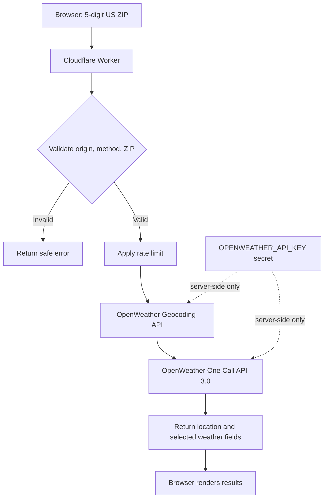

# OpenWeather API proxy

A Cloudflare Worker that keeps an OpenWeather API key server-side and exposes a limited weather endpoint for a browser-based application.

## How it works



The Worker is not a generic URL proxy. It accepts a five-digit US ZIP code and calls fixed OpenWeather endpoints. It returns a reduced response containing location, current conditions, daily forecast data, and weather alerts.

## Requirements

- A Cloudflare account with Workers enabled.
- Node.js and npm.
- An OpenWeather API key with access to One Call API 3.0.

## Configure and deploy

1. Open a terminal in this directory.
2. Authenticate Wrangler with Cloudflare:
   ```sh
   npx wrangler login
   ```
3. Configure a unique positive integer for `ratelimits.namespace_id` in `wrangler.toml`.
4. Add your OpenWeather API key as a Worker secret:
   ```sh
   npx wrangler secret put OPENWEATHER_API_KEY
   ```
   Do not store the key in `wrangler.toml`, client-side code, or source control.
5. Deploy the Worker:
   ```sh
   npx wrangler deploy
   ```
6. Copy the deployed Worker URL. The endpoint used by the client is the Worker URL followed by `/weather`.

## Configure the client

Set the client application's weather endpoint to:

```text
https://<your-worker-hostname>/weather
```

Replace the example hostname with the URL assigned to your deployed Worker. The Worker URL is public; the OpenWeather API key must remain a Worker secret.

## Test the endpoint

Replace `<your-worker-hostname>` with your deployed Worker hostname:

```sh
curl -i "https://<your-worker-hostname>/weather?zip=84010" \
  -H "Origin: https://your-application.example"
```

Use an origin allowed by the Worker configuration. Also test an invalid ZIP code, such as `abc`, and confirm that the Worker returns HTTP 400. Requests from origins not allowed by the Worker should not receive a successful browser response.

## Security and limitations

- The API key is available only to the Worker runtime and is not returned to the browser.
- The endpoint is public. CORS is a browser control, not authentication, and does not prevent direct requests from non-browser clients.
- The rate limiter is approximate and is not a strict global quota or a guarantee against abuse. Use provider-side usage limits and monitor API consumption.
- Upstream failures are returned as generic errors rather than forwarding the provider's response body.
- The example displays only the first weather alert when multiple alerts are returned.
