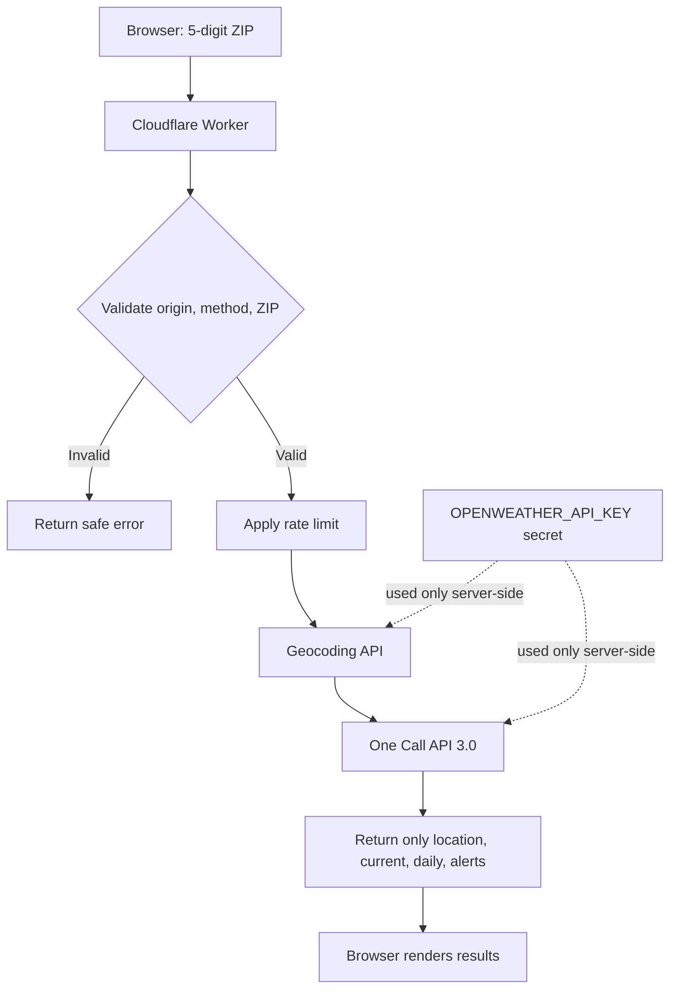

# OpenWeather API proxy

This Worker keeps the OpenWeather API key on the server side. It is designed for the public GitHub Pages portfolio at https://mikekelley89.github.io/.

## Request flow



The Worker is intentionally not a generic URL proxy. It accepts only a five-digit ZIP code and calls two fixed OpenWeather endpoints.

## Deploy it

1. Create a free Cloudflare account if you do not already have one.
2. Install Node.js, then open a terminal in this `worker/` directory.
3. Run `npx wrangler login` and follow the browser sign-in steps.
4. Add the provider key as a Worker secret. Do not put it in `wrangler.toml` or commit it:
   ```sh
   npx wrangler secret put OPENWEATHER_API_KEY
   ```
   Paste the **newly rotated** OpenWeather key when prompted. Do not reuse the old key that was exposed in the public repository.
5. In `wrangler.toml`, change `ratelimits.namespace_id` to a positive integer unique to your Cloudflare account. Keep it numeric.
6. Deploy:
   ```sh
   npx wrangler deploy
   ```
7. Copy the deployed Worker URL. It will look like `https://openweather-proxy.<your-account-subdomain>.workers.dev`.

## Connect both demos

After deployment, edit these two files and replace the `WORKER_BASE_URL` placeholder with your actual Worker URL (do not include `/weather` at the end):

- `../static/js/OpenWeather.js`
- In the portfolio repository: `public/scripts/weather-demo.js`

Use the exact deployed URL followed by `/weather`. The URL is not secret; the OpenWeather key is.

## Test

Replace `<worker-base-url>` with the URL from your deployment:

```sh
curl -i "https://<worker-base-url>/weather?zip=84010" \
  -H "Origin: https://mikekelley89.github.io"
```

Try an invalid ZIP (for example `abc`) and confirm the Worker returns HTTP 400 without contacting OpenWeather. Requests from an unrelated browser origin should be rejected.

## Security and operational notes

- Rotate/revoke the previously exposed OpenWeather key. Removing a key from the latest source does not remove it from Git history or copies already downloaded.
- The secret protects the provider credential from browser visitors; the public Worker endpoint itself is still public.
- The rate-limit binding is approximate and location-local, not a strict global quota. It is a basic safeguard, not an abuse-proof billing control.
- CORS restricts compliant browsers, but it is not authentication and does not prevent non-browser clients from calling the endpoint.
- Keep OpenWeather usage limits and account monitoring enabled. A public proxy can still consume your provider quota.
- The Worker intentionally returns generic upstream errors and never forwards the provider response body.
- The sample only displays the first weather alert, if multiple alerts are returned.
